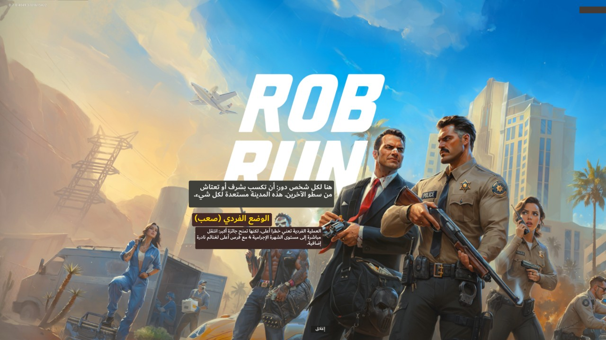

# تعريب ROB RUN

**ترجمة عربية كاملة للعبة ROB RUN، تشتغل فوق اللعبة بدون ما تلمس ملفاتها**

&nbsp;

## وش هو؟

برنامج صغير يقرأ النصوص الإنجليزية في اللعبة ويحط مكانها الترجمة العربية في نفس المكان، في القوائم والشروحات والمتجر والمهام.

- أكثر من **4,800 نص** مترجم يدوياً ومراجَع.
- **ما يعدّل ملفات اللعبة** ولا يدخل على ذاكرتها. يشتغل كطبقة شفافة فوق الشاشة، مثل برامج التسجيل والبث.
- الأرقام والأسعار وأسماء اللاعبين تظل مثل ما هي.
- تقدر توقفه أو تخفيه بضغطة زر.

## التحميل والتشغيل

1. حمّل الملف `RobRun-Arabic-D7omza-v2.0.zip` من **[صفحة الإصدارات](../../releases/latest)** وفك الضغط.
2. في إعدادات اللعبة خلّ وضع العرض **Borderless** أو **Windowed**.
3. شغّل **`RobRunAR.exe`**، وهو يفتح اللعبة من ستيم بنفسه.

> **مهم:** تشغيل اللعبة من ستيم لحالها ما يشغّل الترجمة. افتحها دائماً من `RobRunAR.exe`.

## الاختصارات

| الاختصار | الوظيفة |
|---|---|
| `Ctrl + Alt + A` | تشغيل / إيقاف الترجمة |
| `Ctrl + Alt + H` | إخفاء / إظهار |
| `Ctrl + Alt + Q` | إغلاق البرنامج |

## مشاكل متوقعة وحلها

**طلعت رسالة «Windows protected your PC»**
البرنامج جديد وغير موقّع رقمياً، فويندوز يحذّر منه. اضغط **More info** ثم **Run anyway**.

**طلعت رسالة إن «قارئ النصوص الإنجليزي غير مثبّت»**
الترجمة تعتمد على قارئ النصوص المدمج في ويندوز. ثبّته من:
الإعدادات ← الوقت واللغة ← اللغة والمنطقة ← إضافة لغة ← **English (United States)**
ما يلزم تغيّر لغة جهازك، يكفي إنها تكون مضافة.

**الترجمة تطلع بعد ثانية تقريباً**
هذا طبيعي، البرنامج يقرأ الشاشة أول ثم يترجم.

**بعض النصوص تظل إنجليزي**
الأسماء فوق اللاعبين والنصوص داخل عالم اللعبة تُترك عمداً. إذا لقيت نص في قائمة ما انترجم، علّق لي وأضيفه في التحديث الجاي.

## المتطلبات

- Windows 10 أو 11
- اللعبة على وضع Borderless أو Windowed
- لغة English (United States) مضافة في ويندوز

## الدعم

إذا عجبتك الترجمة، اترك تعليق بسيط في حساباتي، يدعمني كثير 🤍

**YouTube:** @D7omza &nbsp;|&nbsp; **TikTok:** @D7omza

---

### English

Arabic translation for **ROB RUN** by **D7omza**. It runs as a transparent screen overlay: it reads the English UI text with Windows OCR and draws the Arabic translation in place. No game files are modified and nothing is injected into the game process.

**Install:** download the zip from [Releases](../../releases/latest), set the game to Borderless/Windowed, run `RobRunAR.exe` (it launches the game through Steam). Requires Windows 10/11 with the *English (United States)* language installed for OCR.

ROB RUN is a trademark of its respective owners. This is an unofficial fan translation.
